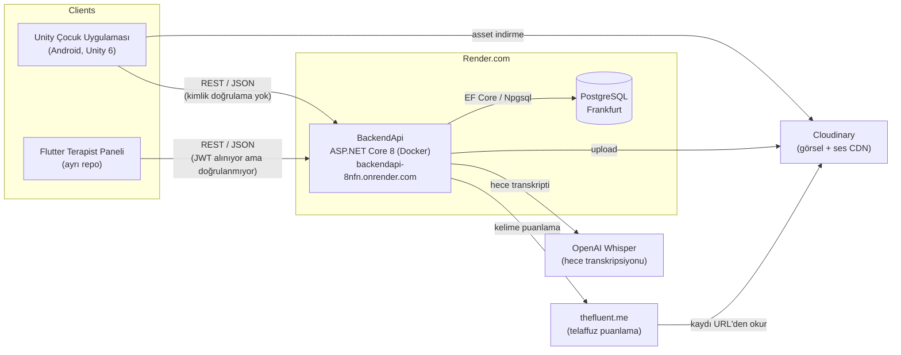
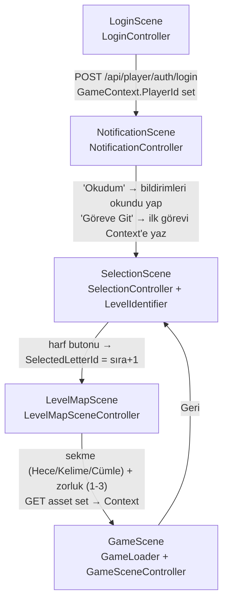
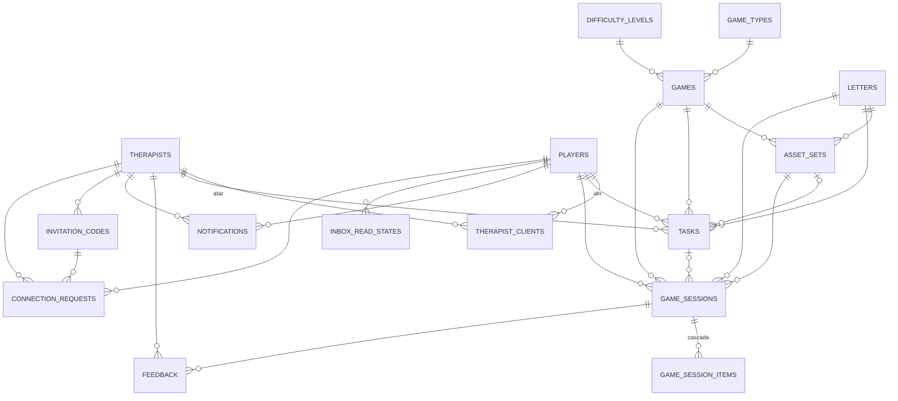
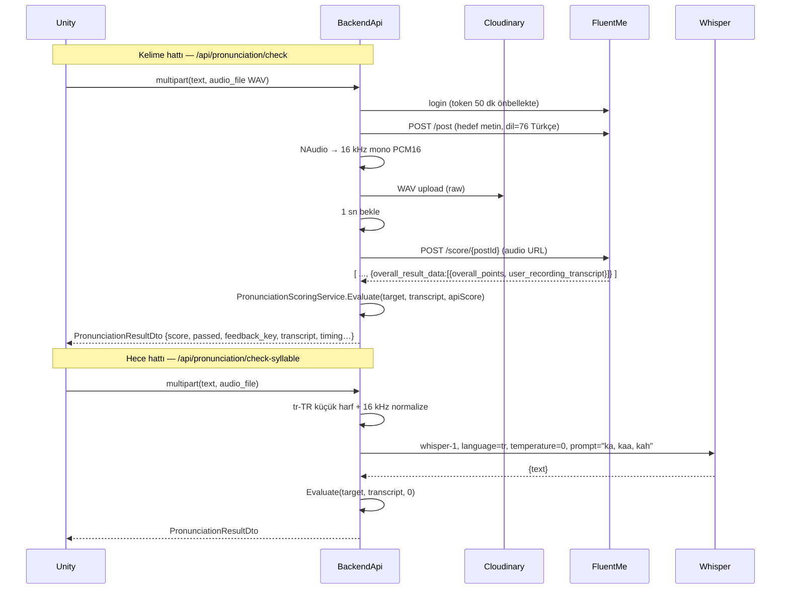
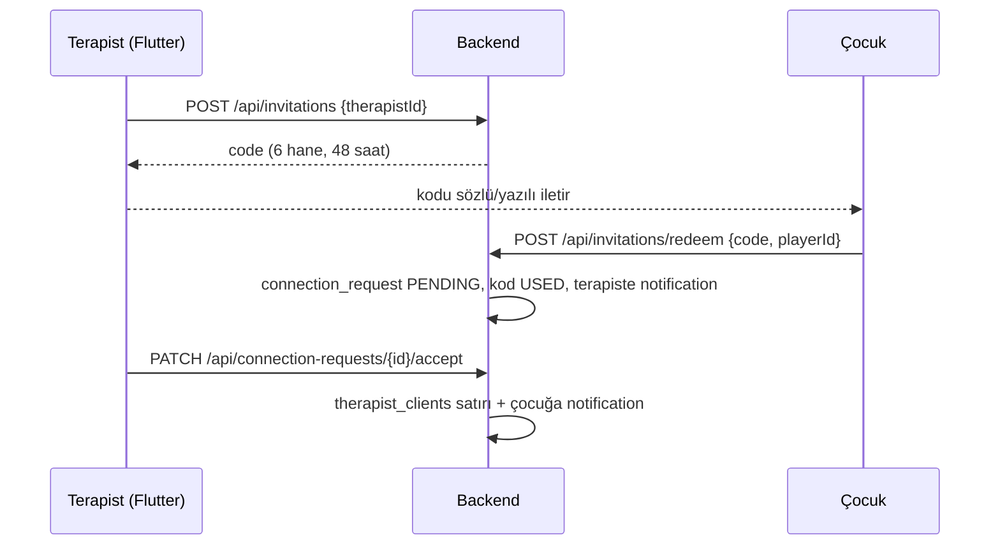
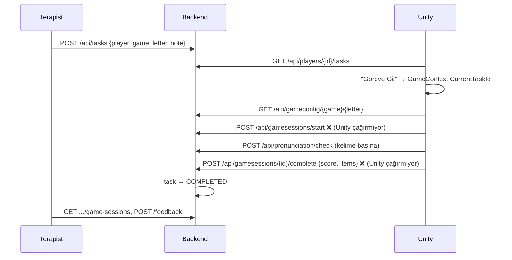

# ParroTalk — Sistem Mimarisi ve Çalışma Rehberi

> **Amaç:** Bu doküman, dil ve konuşma bozukluğu yaşayan çocuklar için geliştirilen ParroTalk sisteminin
> şu anki mimarisini, veri akışlarını, bilinen sorunlarını ve birlikte çalışırken uyacağımız kuralları anlatır.
> Yeni bir işe başlamadan önce ilgili bölümü okuyun; mimariyi değiştiren her PR'da bu dosyayı da güncelleyin.
>
> **Son inceleme:** 2026-10-16 · **İncelenen sürümler:** `GraduationProject@94c8306`, `BackendApi@556f82c`
>
> İş planı ve PR sırası için: **[ROADMAP.md](ROADMAP.md)**

---

## İçindekiler

1. [Ürün Özeti](#1-ürün-özeti)
2. [Sistem Bağlamı](#2-sistem-bağlamı)
3. [Repolar ve Teknoloji Yığını](#3-repolar-ve-teknoloji-yığını)
4. [Unity İstemcisi (Çocuk Uygulaması)](#4-unity-i̇stemcisi-çocuk-uygulaması)
5. [Backend API](#5-backend-api)
6. [Uçtan Uca Akışlar](#6-uçtan-uca-akışlar)
7. [İstemci ↔ Backend Sözleşme Durumu](#7-i̇stemci--backend-sözleşme-durumu)
8. [Bilinen Riskler ve Teknik Borç](#8-bilinen-riskler-ve-teknik-borç)
9. [Çalışma Kuralları](#9-çalışma-kuralları)
10. [Önerilen Yol Haritası](#10-önerilen-yol-haritası)
11. [Açık Sorular](#11-açık-sorular)

---

## 1. Ürün Özeti

ParroTalk, artikülasyon/fonoloji terapisini oyunlaştıran bir sistemdir. Üç kullanıcı yüzeyi vardır:

| Aktör | Uygulama | Ne yapar? |
|---|---|---|
| **Çocuk (Player / Danışan)** | Unity mobil oyun (`GraduationProject`) | Giriş yapar, terapistten gelen bildirim/görevleri görür, harf seçer, hafıza ve hece oyunlarını oynar, kelime/heceyi sesli söyler ve puan alır. |
| **Terapist** | Flutter paneli (ayrı repo, bu incelemede yok) | Danışan ekler, davet kodu üretir, görev atar, oturum geçmişini ve dashboard'u izler, geri bildirim yazar, asset yükler. |
| **Sistem / Admin** | Swagger + Postman | Asset setlerini JSON olarak oluşturur, lookup tablolarını düzeltir, debug listelerini okur. |

**Terapi içeriği modeli:** Türkçe ünsüz harfler (B, C, Ç, D … Z) × oyun tipi (Hece / Kelime / Cümle) × zorluk (1-2-3).
Her `(oyun, harf)` çifti için bir **AssetSet** (görseller, sesler, heceler) vardır.

---

## 2. Sistem Bağlamı



**Önemli gerçekler**

- Tüm iş mantığı **tek bir monolit backend**'dedir; istemciler "ince"dir.
- Medya (görsel/ses) **Cloudinary**'de durur; veritabanında yalnızca URL'ler (AssetSet JSON içinde) tutulur.
- Telaffuz değerlendirmesi **iki ayrı hat** üzerinden yapılır (bkz. [§5.7](#57-telaffuz-değerlendirme-hattı)).
- Render ücretsiz katmanı soğuk başlatma (cold start) yapar; ilk istek 30-60 sn sürebilir.

---

## 3. Repolar ve Teknoloji Yığını

| | **GraduationProject** (istemci) | **BackendApi** (sunucu) |
|---|---|---|
| Dil / Platform | C# · Unity **6000.0.52f1** · URP 2D | C# · **.NET 8** · ASP.NET Core Minimal API + 2 Controller |
| Hedef | Android (`com.DefaultCompany.ParroTalk`) | Docker → Render (port 10000) |
| Ana paketler | Newtonsoft.Json, TextMeshPro, Input System, uGUI | EF Core 8 + Npgsql, JwtBearer, Swashbuckle, CloudinaryDotNet, NAudio, Dapper (kullanılmıyor) |
| Proje adı | `ParroTalk` | `DktApi` (namespace) |
| Test | Yok | Yok |
| CI | Yok | Yok (Render, `main`'e push ile otomatik deploy) |

---

## 4. Unity İstemcisi (Çocuk Uygulaması)

### 4.1 Klasör yapısı

```
Assets/
├── Scenes/              LoginScene → NotificationScene → SelectionScene → LevelMapScene → GameScene
├── Prefabs/
│   ├── Game/            MemoryCard_Prefab, MemoryGameModule
│   └── UI/              LoginPanel, NotificationPanel, MapUI, LevelButton, TaskItem
├── Scripts/
│   ├── Managers/        APIManager, AssetLoader, PronunciationManager, MemoryGameManager,
│   │                    UIPanelManager, GameLoader, AudioManager, TestGame
│   ├── Games/           BaseGameManager (abstract), SyllableExerciseManager
│   ├── Controllers/     Sahne controller'ları + kart/drag/mic bileşenleri
│   ├── Models/          Backend DTO'ları (AssetSetDto, TaskItem, NotificationItem, …)
│   ├── Utilities/       GameContext (global state), GameConstants, WavUtility, UnityExtensions
│   ├── Editor/          LevelPathEditor (harita yolu editör aracı)
│   └── (kök)            LoginManager, PronunciationApi, PronunciationDemo, WavEncoder, LevelIdentifier
├── images/              UI görselleri
└── Free UI Click Sound Effects Pack/, Plugins/ButtonSoundsEditor/   (3. parti)
```

### 4.2 Sahne akışı

Build Settings sırası: `LoginScene(0) → NotificationScene(1) → SelectionScene(2) → LevelMapScene(3) → GameScene(4)`.



### 4.3 Çalışma zamanı bileşenleri

| Bileşen | Ömür | Sorumluluk |
|---|---|---|
| `APIManager` | Singleton, `DontDestroyOnLoad` | Tüm REST çağrıları (`UnityWebRequest` + `async/await`). Base URL Inspector'dan. JWT alanı var ama hiç set edilmiyor. |
| `AssetLoader` | Singleton, `DontDestroyOnLoad` (yalnızca GameScene'de bulunur) | 3 katmanlı önbellek: **RAM → disk (`persistentDataPath`) → ağ**. Sprite ve AudioClip. |
| `SceneNavigator` | Singleton, `DontDestroyOnLoad` (LoginScene'de) | Sahne geçişleri; `IsFocusMode` sıfırlama. |
| `PronunciationManager` | Singleton, `DontDestroyOnLoad` (GameScene'de) | Mikrofon kaydı → WAV → `POST /api/pronunciation/check` → puan döngüsü. |
| `UIPanelManager` | Sahne içi singleton | Victory / Retry / Pronunciation panellerini isimle bulup aç/kapa. |
| `GameContext` | `static class` | Sahneler arası **tüm global durum**: PlayerId, seçili harf/oyun/zorluk, asset URL listeleri, aktif TaskId. |
| `AudioManager` | — | **Hiçbir sahnede yok**; `AudioManager.Instance` her zaman `null`. |

### 4.4 Oyun modülü mimarisi

```mermaid
classDiagram
    class BaseGameManager {
        <<abstract>>
        +InitializeGame(letterId) Task
        #ApplyAssetSet(AssetSetDto) Task
        +InitializeFromContext() Task
        #GameCompleted()
    }
    class MemoryGameManager {
        gameId = 4
        GET /api/gameconfig/4/{letterId}
        kart eşleştir → PronunciationManager
    }
    class SyllableExerciseManager {
        UI'ı runtime'da kurar
        hece seç → dinle → kaydet → puan
        (hiçbir sahneye/prefaba bağlı değil)
    }
    BaseGameManager <|-- MemoryGameManager
    BaseGameManager <|-- SyllableExerciseManager
    GameLoader --> BaseGameManager : GameModules[GameId] → Instantiate
```

- `GameLoader`, `GameContext.SelectedGameType` metnini oyun ID'sine çevirir (`Memory→4`, `Matching→5`, `SYLLABLE/Hece→6`) ve
  Inspector'daki `GameModules` listesinden prefab seçer. **Şu an listede yalnızca `GameId: 4` (Hafıza) var.**
- `GameSceneController` de aynı sahnede `CurrentGameManager.InitializeGame(...)` çağırır → iki başlatıcı birlikte çalışıyor (bkz. §8).
- **Yeni oyun eklemek:** `BaseGameManager`'dan türet → prefab yap → `GameLoader.GameModules`'e backend'deki `games.id` ile ekle (bkz. §9.4).

### 4.5 Hafıza oyunu + telaffuz akışı (şu an çalışan tek oyun)

1. `MemoryGameManager` → `GET /api/gameconfig/4/{letterId}` → `{ base_url, items:[{key,file}] }`
2. Her `item` için `base_url + file` Cloudinary'den indirilir; `key == "background"` kart arkası olur.
3. Kartlar ikişer kopyalanıp karıştırılır; eşleşme `sprite.name.GetHashCode()` ile kontrol edilir.
4. Tüm çiftler bulununca `PronunciationManager.StartPronunciationSession(items)`:
   her kelime için kart büyütülür, çocuk mikrofona **basılı tutarak** (`MicHoldHandler`) söyler,
   WAV (`WavEncoder`, 16 kHz) backend'e gönderilir, **puan ≥ 70** olana kadar tekrar edilir.
5. Hepsi geçilince Victory paneli açılır. **Sonuç backend'e kaydedilmez** (bkz. §7).

### 4.6 Ölü / deneysel kod

| Dosya | Durum |
|---|---|
| `LoginManager.cs`, `Assets/Login_Scene.unity` | Eski login denemesi; Build Settings'te değil. |
| `PronunciationApi.cs`, `PronunciationDemo.cs` | Demo; base URL placeholder (`https://<render-domainin>`). `PronunciationDemo` GameScene'de duruyor. |
| `TestGame.cs`, `AudioManager.cs` | Sahneye bağlı değil. |
| `SyllableExerciseManager.cs`, `SyllableCard.cs` | Kod tamam ama sahneye bağlanmamış. |
| `WavUtility.cs` vs `WavEncoder.cs` | İki ayrı WAV encoder; yalnızca `WavEncoder` kullanılıyor. |
| `Models/User.cs`, `PronunciationResult.cs`, `PlayerTaskDto.cs` | Kullanılmıyor. |
| `MapDragController`, `MapScrollDrag`, `ContentDrag`, `SuperSimpleDrag` | Aynı işi yapan 4 drag script'i. |

---

## 5. Backend API

### 5.1 Katmanlar

```
BackendApi/
├── Program.cs                 DI, JWT, CORS, Swagger, otomatik migration, endpoint mapping
├── Endpoints/*.cs             Minimal API grupları (iş mantığının %90'ı burada, doğrudan DbContext ile)
├── Controllers/               GameConfigController, PronunciationController (MVC)
├── Services/                  CloudinaryService, WhisperService, PronunciationScoringService,
│                              GameService (+ Repository/GameRepository), FluentMeService (kullanılmıyor)
├── Models/Db/                 EF Core entity'leri + AppDbContext
├── Models/Auth, Models/Game   İstek/yanıt modelleri
├── Dtos/                      DTO'lar (Game, Player, Tasks, Therapist, Pronunciation)
├── Migrations/                EF Core migration'ları
├── Dockerfile                 Render deploy imajı
└── PostmanCollection.json     Manuel test koleksiyonu
```

**Desen:** Pratikte "Endpoint → DbContext" (transaction script). Service/Repository katmanı yalnızca `gameconfig` için var.
Bu, küçük ekip için hızlıdır ama iş kuralları endpoint'lere dağılmış durumdadır.

### 5.2 Başlangıç (Program.cs)

1. `FLUENT_USER` env kontrol log'u (artık kullanılmıyor; değerler koda gömülü).
2. Connection string: `ConnectionStrings:Pg` → yoksa `DATABASE_URL`.
3. DI: `GameRepository`, `GameService`, `CloudinaryService`, `JwtHelper`, `PronunciationScoringService`, `WhisperService` (hepsi Scoped).
4. CORS `AllowFlutter`: her origin/header/method serbest.
5. JWT Bearer şeması kayıtlı **ama hiçbir endpoint `RequireAuthorization()` kullanmıyor.**
6. Swagger her ortamda açık.
7. **Uygulama açılışında `db.Database.Migrate()`** çalışır.

### 5.3 Veri modeli



| Tablo | Not |
|---|---|
| `therapists`, `players` | Şifreler **düz metin**. `players` kişisel/sağlık verisi içerir (doğum tarihi, tanı, veli telefonu, okul). |
| `therapist_clients` | Composite PK `(therapist_id, player_id)`. N-N ilişki. |
| `letters`, `game_types`, `difficulty_levels`, `games` | Lookup/katalog tabloları. |
| `asset_sets` | `(game_id, letter_id)` **unique**. İçerik `asset_json` (text) kolonunda serbest JSON. Zorluk ayrı kolon değil; oyun ID'sine gömülü. |
| `tasks` | Durum: `ASSIGNED` → `COMPLETED` (oturum tamamlanınca). |
| `game_sessions` + `game_session_items` | Oturum skoru + kelime/hece bazında detay (`item_type`: WORD/SYLLABLE/SENTENCE/PHONEME/MATCH). |
| `feedback` | Terapistin oturuma yorumu. |
| `notifications` | Terapist→çocuk (ve davet akışında çocuk→terapist) mesajları; `is_read`. |
| `inbox_read_states` | Birleşik gelen kutusu için okundu bilgisi; `source_type`: task / feedback / notification. |
| `invitation_codes` | 6 karakter, 48 saat geçerli. `PENDING → USED / EXPIRED / CANCELLED`. Terapist başına en fazla 10 PENDING. |
| `connection_requests` | `PENDING → ACCEPTED / REJECTED`. Kabulde `therapist_clients`'a satır eklenir. |

### 5.4 Oyun kataloğu (`games.id`)

`/api/admin/fix-lookups-and-games` endpoint'inin yazdığı kanonik liste:

| ID | Tip | Zorluk | Ad | Unity karşılığı |
|---|---|---|---|---|
| 1 | Hece | 1 | Hece S1 - 2 Harfliler | `SyllableExerciseManager` (bağlı değil) |
| 2 | Hece | 2 | Hece S2 - 3 Harfliler | 〃 |
| 3 | Hece | 3 | Hece S3 - 4 Harfliler | 〃 |
| 4 | Kelime | 1 | Kelime S1 - Hafıza Kartı | ✅ `MemoryGameManager` |
| 5 | Kelime | 2 | Kelime S2 - Üçlü Eşleştir | — |
| 6 | Kelime | 3 | Kelime S3 - Mesleği Bul | — (Unity `SYLLABLE`'ı yanlışlıkla 6'ya eşliyor) |
| 7 | Kelime | 3 | Kelime S3 - Gölgesini Bul | — |
| 8 | Cümle | 1 | Cümle S1 - Cümle Kur! | — |
| 9 | Cümle | 2 | Cümle S2 - Fill Gap | — |
| 10 | Cümle | 3 | Cümle S3 - Story | — |

> **Kural:** Oyun ID'leri hem Unity `GameLoader` hem Flutter hem de asset JSON'larında sabit kodlu. Bu tablo **tek doğru kaynak**tır; değişirse her üç tarafı birlikte güncelleyin.

### 5.5 AssetSet JSON şeması

`asset_sets.asset_json` serbest metin olduğundan şema sözleşmeyle korunur. Backend DTO'su (`Dtos/Game/GameAssetConfig.cs`):

```json
{
  "config_id": "K_Kelime_Memory",
  "base_url": "https://res.cloudinary.com/<cloud>/image/upload/.../letters/K/kelime/memoryGame/",
  "audio_base_url": "https://res.cloudinary.com/<cloud>/video/upload/...",
  "items": [
    { "key": "background", "file": "background.png" },
    { "key": "kedi", "file": "kedi.png", "audio": "kedi.mp3" }
  ]
}
```

- `GET /api/gameconfig/{gameId}/{letterId}` bu JSON'ı **olduğu gibi** döner (backend parse etmez).
- Unity `GameAssetConfig` modeli `baseUrl` / `configId` (camelCase) bekliyor; backend örneği `base_url` (snake_case). **Veritabanındaki gerçek JSON'ların hangi biçimde olduğu doğrulanmalı** (bkz. §11).
- Cloudinary klasör düzeni: `graduationProject/letters/{HARF}/{tip}/{oyun}/`, yüklenen sesler `game_audio/`, telaffuz kayıtları `pronunciation/`.

### 5.6 Endpoint kataloğu

Hiçbiri kimlik doğrulama istemez. "Tüketici" sütunu kodda görülen kullanıcıyı gösterir.

**Kimlik**

| Metot | Yol | Tüketici |
|---|---|---|
| POST | `/api/auth/login`, `/api/auth/register` | Flutter (terapist; JWT döner) |
| POST | `/api/player/auth/login` | Unity |
| POST | `/api/player/auth/register` | (Unity'de metot var, kullanılmıyor) |

**Danışan / Terapist**

| Metot | Yol | Not |
|---|---|---|
| GET/POST | `/api/students?therapistId=` | Terapistin danışan listesi / yeni danışan |
| GET | `/api/students/{id}` | ⚠️ Player entity'sini **şifre dahil** döner |
| PATCH | `/api/students/{id}`, `/api/players/{id}` | Kısmi güncelleme |
| GET | `/api/players`, `/api/players/{id}/therapists` | Debug / ilişki |
| GET/PUT | `/api/therapists/{id}`, `/api/therapists/{id}/password` | ⚠️ GET şifre dahil döner |
| GET | `/api/students/{id}/stats`, `/api/dashboard/summary` | Flutter dashboard |

**Davet ve bağlantı**

| Metot | Yol | Not |
|---|---|---|
| POST/GET/DELETE | `/api/invitations` | Terapist kod üretir/listeler/iptal eder |
| POST | `/api/invitations/redeem` | Çocuk kodu kullanır (IP başına 10/dk, in-memory). **Unity'de ekranı yok.** |
| GET/PATCH | `/api/connection-requests`, `/{id}/accept`, `/{id}/reject` | Terapist onayı |

**Görev, bildirim, gelen kutusu**

| Metot | Yol | Tüketici |
|---|---|---|
| POST | `/api/tasks` | Flutter |
| GET | `/api/therapists/{id}/tasks`, `/api/therapists/{id}/notifications` | Flutter |
| GET | `/api/players/{id}/tasks`, `/api/players/{id}/tasks/active` | Unity (ilki) |
| POST/GET/DELETE | `/api/notifications…` | Flutter gönderir, Unity okur |
| POST | `/api/notifications/{id}/read` | Unity |
| GET/POST | `/api/players/{id}/inbox`, `/inbox/unread-count`, `/inbox/{type}/{id}/read`, `/inbox/read-all` | Yeni birleşik gelen kutusu (Unity henüz kullanmıyor) |

**Oyun içeriği ve oturumlar**

| Metot | Yol | Not |
|---|---|---|
| GET | `/api/lookup/letters`, `/games`, `/gametypes`, `/difficultylevels` | Katalog |
| GET | `/api/gameconfig/{gameId}/{letterId}` | Unity hafıza oyunu. `gameId == 1` için **sabit mock JSON** döner. |
| POST/PUT | `/api/assets/create`, `/api/assets/bulk-create`, `/api/assets/{g}/{l}/json` | Asset yönetimi |
| GET | `/api/asset-sets`, `/api/tasks/{id}/asset-set` | Asset sorgulama |
| POST | `/api/media/upload`, `/api/media/upload-audio` | Cloudinary upload |
| POST | `/api/gamesessions/start`, `/{id}/progress`, `/{id}/complete` | Oturum yaşam döngüsü (complete → task `COMPLETED`) |
| GET/POST | `/api/gamesessions/{id}`, `/{id}/feedback`, `/all`, `/api/therapists/{t}/players/{p}/game-sessions` | Geçmiş + geri bildirim |
| POST | `/api/admin/fix-lookups-and-games` | Tek seferlik veri düzeltme |

**Telaffuz**

| Metot | Yol | Motor |
|---|---|---|
| POST | `/api/pronunciation/check` (form: `text`, `audio_file`) | FluentMe |
| POST | `/api/pronunciation/check-syllable` (form: `text`, `audio_file`) | OpenAI Whisper |

### 5.7 Telaffuz değerlendirme hattı



**Puanlama kuralları** (`PronunciationScoringService`, Türkçe karakterler ASCII'ye indirgenerek karşılaştırılır):

| Durum | Puan | `feedback_key` |
|---|---|---|
| Transkript boş | 0 | `no_audio` |
| Tam eşleşme | 100 | `exact_match` |
| Uzatma varyantı (`aah` ~ `ah`) | 85 | `length_variant` |
| Biri diğerini içeriyor | 70 | `contains` |
| Hedef ≤ 3 karakter ve eşleşmiyor | 0 | `mismatch_short` |
| Diğer (uzun kelime) | FluentMe skoru | `api_score` |

Geçme eşiği: **70** (backend `passed`, Unity de sabit 70 kullanıyor).

> ⚠️ Normalize işlemi `ı→i`, `ş→s` vb. yapar; bu nedenle **"kız" ile "kiz"** veya **"şapka" ile "sapka"** aynı sayılır.
> Konuşma terapisi bağlamında (ör. /s/–/ş/ ayrımı hedefleniyorsa) bu bilinçli bir karar olmalı.

### 5.8 Veritabanı migration'ları

- Şema ilk olarak EF dışında oluşturulmuş; `Baseline` migration'ı boş (yalnızca başlangıç noktası).
- Sonraki migration'lar: `RefactorGameSessionAndAddItems`, `FixGameSessionItemsTable`, `AddInboxReadStates`, `AddInvitationAndConnectionRequest`.
- **Migration'lar uygulama açılışında otomatik çalışır** → hatalı bir migration production'ı ayağa kalkamaz hale getirir.

Yeni migration:

```bash
dotnet ef migrations add <Isim> --project DktApi.csproj
```

### 5.9 Dağıtım ve yapılandırma

- `Dockerfile` çok aşamalı (sdk:8.0 → aspnet:8.0), `ASPNETCORE_URLS=http://+:10000`.
- Render, repoya push ile yeniden deploy eder.

| Ortam değişkeni | Kullanan | Not |
|---|---|---|
| `ConnectionStrings__Pg` veya `DATABASE_URL` | Program.cs | ⚠️ Şu an `appsettings*.json` içinde açık yazılı |
| `Jwt__Key`, `Jwt__Issuer`, `Jwt__Audience` | JwtHelper | ⚠️ Key `appsettings.json`'da varsayılan değerde |
| `CLOUDINARY_CLOUD_NAME`, `CLOUDINARY_API_KEY`, `CLOUDINARY_API_SECRET` | CloudinaryService | Env'den okunuyor ✅ |
| `OPENAI_API_KEY` | WhisperService | Env'den okunuyor ✅ |
| `FLUENT_USER` (+ şifre, API key) | PronunciationController | ⚠️ Kod içinde sabit; env okunmuyor |

Yerel çalıştırma: `dotnet run` → `http://localhost:5194/swagger`
(**Dikkat:** yerel geliştirme şu an production veritabanına bağlanıyor.)

---

## 6. Uçtan Uca Akışlar

### 6.1 Terapist ↔ çocuk bağlantısı



Alternatif yol: Terapist `POST /api/students` ile çocuğu doğrudan oluşturur (ilişki otomatik eklenir).

### 6.2 Görev → oyun → sonuç (hedeflenen akış)



❌ işaretli adımlar backend'de hazır ama istemcide eksik → **terapist paneli şu an Unity'den gelen hiçbir oyun sonucunu göremez.**

---

## 7. İstemci ↔ Backend Sözleşme Durumu

| Unity çağrısı | Backend'de | Etki |
|---|---|---|
| `POST /api/player/auth/login` | ✅ var | — |
| `GET /api/players/{id}/tasks` | ✅ var | — |
| `GET /api/notifications/player/{id}`, `POST /api/notifications/{id}/read` | ✅ var | — |
| `GET /api/gameconfig/{g}/{l}` | ✅ var | Alan adları (`base_url` vs `baseUrl`) doğrulanmalı |
| `GET /api/assets/sets?letterId&gameType&difficulty` | ❌ **yok** | 404 → Unity sessizce **mock** veri üretir; hece/kelime sekmesi gerçek veri almaz |
| `GET /api/notifications/unread-count/{id}` | ❌ **yok** (karşılığı `/api/players/{id}/inbox/unread-count`) | Hep 0 → kod test için 1'e zorluyor |
| `POST /api/gamesessions/finish` | ❌ **yok** (karşılığı `start` + `complete`) | Metot zaten çağrılmıyor; skor kaydı yok |
| `POST /api/player/auth/register` | ⚠️ alan uyuşmazlığı | Unity `FullName` gönderir, backend `Name` + `BirthDate` bekler |
| `POST /api/pronunciation/check` | ⚠️ **yanıt formatı değişmiş** | Backend artık `PronunciationResultDto` **nesnesi** dönüyor; Unity FluentMe'nin ham **dizisini** (`responseList[1].OverallResult[0].overall_points`) parse ediyor → parse hatası → çocuk her denemede "Tekrar dene" görür |
| `POST /api/pronunciation/check-syllable` | ✅ var | Unity kullanmıyor (hece oyunu `/check`'e gidiyor) |

> **Not:** Bu tablo statik kod incelemesine dayanır. Render'daki canlı sürüm farklıysa önce `/swagger` ile doğrulayın.

---

## 8. Bilinen Riskler ve Teknik Borç

### P0 — Güvenlik ve gizlilik (çocuk sağlık verisi işleniyor)

1. **Sırlar git geçmişinde.** Production PostgreSQL şifresi (`appsettings.json`, `appsettings.Development.json`),
   FluentMe kullanıcı adı/şifre/API anahtarı (`PronunciationController.cs`) ve JWT anahtarı repoda açık.
   **Her iki repo da public** olduğundan bu bilgiler herkese açıktır.
   → Hepsi **yenilenmeli (rotate)** ve env değişkenine taşınmalı (ROADMAP: ADIM 0 + PR-01).
2. **Kimlik doğrulama yok.** JWT üretiliyor ama hiçbir endpoint korunmuyor. Herkes `GET /api/players`,
   `GET /api/students/{id}` ile tüm çocukların ad, e-posta, tanı, veli telefonu ve **şifresini** okuyabilir; şifre değiştirebilir.
3. **Şifreler düz metin** (therapist + player).
4. **Entity'ler doğrudan dönülüyor** (`Results.Ok(player)`, `Results.Ok(therapist)`) → şifre sızıntısı.
5. Hata yanıtlarında stack trace dönülüyor (`GET /api/students`), Swagger production'da açık, CORS tamamen açık.
6. Yerel geliştirme production DB'ye yazıyor.
7. KVKK: çocuk ses kayıtları Cloudinary `pronunciation/` klasöründe süresiz ve herkese açık URL ile tutuluyor; FluentMe/OpenAI'ye gönderiliyor. Aydınlatma metni/veli onayı ve saklama süresi tanımlanmalı.

### P1 — İşlevsel kırıklar

1. Telaffuz yanıt formatı uyuşmazlığı (§7) → hafıza oyunu sonrası telaffuz aşaması geçilemiyor olabilir.
2. Oyun sonuçları backend'e kaydedilmiyor → dashboard / görev tamamlama Unity için çalışmıyor.
3. `/api/assets/sets` yok → LevelMap her zaman mock veri.
4. `SyllableExerciseManager` sahneye bağlı değil; `GameLoader` `SYLLABLE → 6` eşlemesi yanlış (backend'de hece = 1-3).
5. `PronunciationManager.CreatePronunciationCard` görsel URL'ini `APIManager.GetBaseUrl() + file` ile kuruyor (backend adresi) — `config.BaseUrl` (Cloudinary) olmalı.
6. GameScene'de hem `GameLoader` hem `GameSceneController` oyunu başlatıyor → çift init / çift API çağrısı riski.
7. Harf ID'si Unity'de **sabit dizideki sıra** ile üretiliyor (`B=1, C=2 …`) → `letters` tablosundaki ID'lerle eşleştiği doğrulanmalı.
8. Unity'de davet kodu kullanma (redeem) ve kayıt ekranı yok.
9. `AudioManager` sahnede yok → tüm ses efektleri sessiz.
10. `PronunciationManager` sabit kelime düzeltmeleri (`kopek→köpek` vb.) içeriyor → asset JSON'a `display_text` alanı eklenmeli.

### P2 — Kod kalitesi

- Test yok, CI yok, ortam ayrımı (dev/staging/prod) yok.
- `Console.WriteLine` ile loglama → `ILogger` + yapılandırılmış log.
- Endpoint'lerde tekrarlanan doğrulama/eşleme kodu; `Dtos.cs` ve `Dtos/` paralel; Unity `GraduationProject.Models` namespace'i backend `Dtos/Game/GameAssetConfig.cs`'e kopyalanmış.
- `DateTime.Now` / `DateTime.UtcNow` karışık (ör. `Notification.CreatedAt` yerel saat).
- In-memory rate limit tek instance'ta çalışır; `Random` ile davet kodu (kriptografik değil).
- Unity: `async void` yaygın (hatalar yutulur), `GameObject.Find` / isimle arama, `GameContext` global mutable state, base URL iki yerde sabit kodlu, `Debug.Log` yoğun, aynı işi yapan çoklu script.
- `DktApi.csproj` içinde yorum satırına alınmış eski proje tanımı; kullanılmayan `Dapper`, `FluentMeService`.

---

## 9. Çalışma Kuralları

### 9.1 Branch ve commit

> PR yaşam döngüsü, roller ve "Bitti" tanımı: [ROADMAP.md §1](ROADMAP.md#1-nasıl-çalışacağız).

- `main` = Render'a otomatik deploy edilen kod. Doğrudan `main`'e push yok; her iş `feature/PR-XX-<kısa-ad>` veya `fix/PR-XX-<kısa-ad>` dalında, PR ile.
- Commit mesajı: `<alan>: <ne yapıldı>` (ör. `backend: add RequireAuthorization to player endpoints`, `unity: parse PronunciationResultDto`). `.` gibi boş mesajlar yok.
- Unity sahne/prefab dosyaları (`.unity`, `.prefab`) birleştirmede çakışır: aynı sahne üzerinde aynı anda iki kişi çalışmasın.

### 9.2 API değişikliği protokolü

1. Önce bu dokümandaki §5.6 / §7 tablolarını güncelle.
2. Yanıt şeklini değiştiriyorsan **eski istemcileri kırma**: yeni alan ekle veya `/v2` yolu aç.
3. Unity `Models/` ve Flutter modelini aynı PR serisinde güncelle.
4. Swagger'da elle test et, Postman koleksiyonunu güncelle.

### 9.3 Sır yönetimi

- Hiçbir şifre, anahtar veya connection string repoya girmez. Yerelde `dotnet user-secrets`, Render'da Environment.
- `appsettings.json` yalnızca sır olmayan varsayılanları içerir.

### 9.4 Yeni oyun modülü ekleme (Unity)

1. Backend'de `games` tablosunda ID'yi belirle (§5.4) ve her harf için `asset_sets` JSON'unu oluştur (`POST /api/assets/create`).
2. Unity'de `BaseGameManager`'dan türeyen sınıf yaz; `InitializeGame(letterId)` içinde `GET /api/gameconfig/{gameId}/{letterId}` kullan.
3. Prefab oluştur, `GameScene > GameLoader.GameModules` listesine `GameId` ile ekle; `ParseGameType` eşlemesini güncelle.
4. Oyun başında `gamesessions/start`, bitişte `gamesessions/{id}/complete` çağır (item bazında skorlarla).
5. Bu dokümana ekle.

### 9.5 Yeni endpoint ekleme (Backend)

1. İlgili `Endpoints/<Alan>Endpoints.cs` dosyasına ekle (yeni alan ise yeni dosya + `Program.cs`'te `Map…`).
2. İstek/yanıt için `Dtos/<Alan>/` altında DTO kullan; **entity döndürme**.
3. `.WithTags(...)` ve `.WithName(...)` ver; kimlik gerekiyorsa `.RequireAuthorization()`.
4. Şema değiştiyse migration ekle ve yerelde **production dışı** bir DB'de dene.

---

## 10. Önerilen Yol Haritası

> Özet tablodur; PR bazında adımlar, bağımlılıklar ve kabul kriterleri [ROADMAP.md](ROADMAP.md)'dedir.

| Faz | Hedef | İçerik |
|---|---|---|
| **0 — Güvenli zemin** (hemen) | Sızıntıyı durdur | Sırları rotate et + env'e taşı; ayrı dev veritabanı; entity yerine DTO dön; Swagger'ı prod'da kapat. |
| **1 — Uçtan uca çalışan akış** | Çocuğun oynadığı terapiste ulaşsın | Unity `PronunciationResultDto`'yu parse etsin; `gamesessions/start` + `complete` entegrasyonu; `/api/assets/sets` yerine doğru endpoint; hece oyununu `GameLoader`'a bağla ve `check-syllable` kullan; unread-count'u inbox endpoint'ine taşı. |
| **2 — Kimlik ve yetki** | Herkes yalnızca kendi verisini görsün | Şifre hash (BCrypt/ASP.NET `PasswordHasher`); oyuncu için de JWT; endpoint'lere rol bazlı `RequireAuthorization`; terapist yalnızca `therapist_clients`'taki çocukları görsün. |
| **3 — Mühendislik altyapısı** | Güvenle hızlanmak | GitHub Actions (backend build + test, Unity build); `PronunciationScoringService` için birim testleri; `ILogger`; ortam ayrımı (staging). |
| **4 — Ürün** | Terapötik değer | Kelime S2-S3 ve Cümle oyunları; çocuk ilerleme haritası backend'den; veli onay akışı; ses kayıtlarının saklama politikası. |

---

## 11. Açık Sorular

1. Flutter terapist panelinin reposu nerede? Bu dokümana eklenmeli mi?
2. Veritabanındaki gerçek `asset_json` kayıtları `base_url` mı `baseUrl` mı kullanıyor?
3. `letters` tablosundaki ID'ler Unity'deki `B=1 … Z=20` sırasıyla örtüşüyor mu (sesli harfler de var mı)?
4. Render'daki canlı backend bu repodaki `main` ile aynı mı? (Unity'nin çağırdığı `/api/assets/sets` canlıda var mı?)
5. Kelime değerlendirmesi uzun vadede FluentMe'de mi kalacak, yoksa Whisper hattında mı birleşecek?
6. `ş/s`, `ç/c`, `ı/i` ayrımı terapötik olarak puanlamada önemli mi?
7. Çocuk kendi hesabını mı açacak, yoksa hesapları yalnızca terapist mi oluşturacak?
