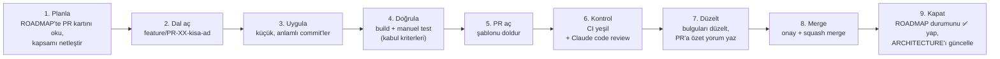
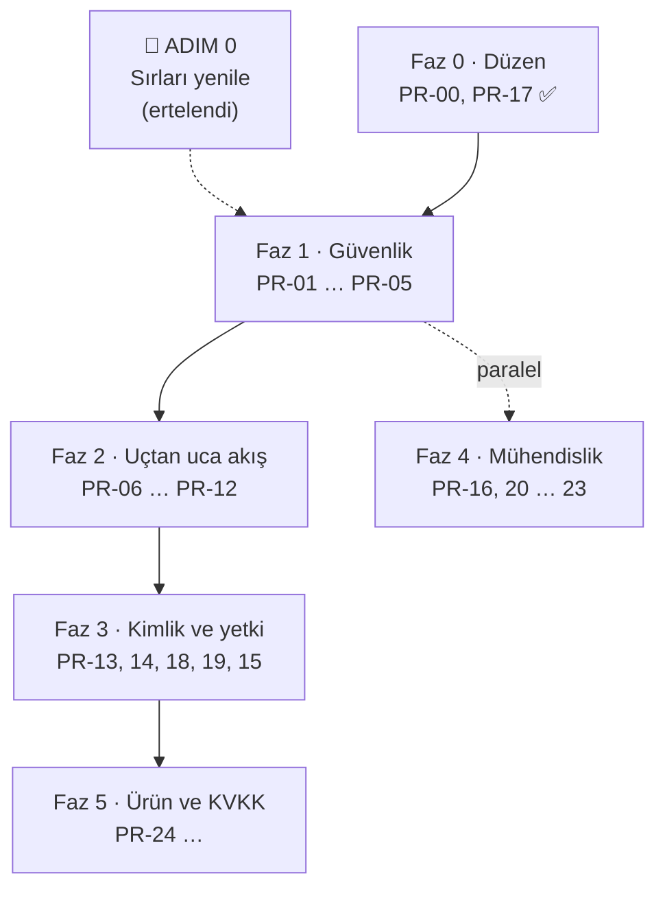

# ParroTalk — PR Yol Haritası

> Bu dosya [ARCHITECTURE.md](ARCHITECTURE.md)'deki bulguların **önceliklendirilmiş iş planıdır**.
> Her satır bir PR'dır. Durum değişiklikleri `docs/roadmap-durum` dalında toplanıp doküman PR'ıyla `main`'e alınır.
>
> **Repo kısaltmaları:** `BE` = [BackendApi](https://github.com/bitirmesel/BackendApi) · `FN` = [Fonem](https://github.com/bitirmesel/Fonem) (Flutter çocuk) · `PN` = [advisor_panel_app](https://github.com/bitirmesel/advisor_panel_app) (Flutter terapist) · `UN` = [GraduationProject](https://github.com/bitirmesel/GraduationProject) (Unity, emekli)
>
> **Durum:** ⬜ başlamadı · 🔧 yapılıyor · 🟨 PR açık · ✅ merge edildi · ⏸️ beklemede · 🗑️ iptal

---

## 1. Nasıl çalışacağız?

### 1.1 Bir PR'ın yaşam döngüsü

Her adımda ne yaptığımızı açıkça yazarız: PR açıklamasında **Ne / Neden / Nasıl test edildi / Riskler** bölümleri zorunludur (bkz. `.github/pull_request_template.md`).

**Kontrol adımı:** CI'ı olan repolarda (şimdilik BE; FN ve PN için PR-20) GitHub Actions yeşil olmalı. Her PR Claude code review'dan geçer; bulgular PR'a satır içi yorum olarak yazılır, düzeltilenler ayrı bir yorumla özetlenir. Ertelenen bulgular ROADMAP'te ilgili karta not edilir.

### 1.2 Kurallar

| Kural | Açıklama |
|---|---|
| **`main`'e doğrudan push yok** | BE `main` = Render'a otomatik deploy edilen kod. Her değişiklik PR ile girer. GitHub'da branch protection açılması önerilir. |
| **Dal adı** | `feature/PR-07-gorev-yonlendirme`, `fix/PR-09-bildirim-post` — ROADMAP'teki ID ile başlar. |
| **PR başlığı** | `[PR-07] Fonem: görev yönlendirmesini oyun tipi ve zorlukla yap` |
| **Küçük PR** | Bir PR tek bir amaca hizmet eder; ~400 satırı geçiyorsa bölünür. |
| **Geriye uyumluluk** | BE merge'ü anında canlıya çıkar. BE PR'ı **kullanımdaki Fonem ve panel sürümlerini kırmamalı**: yeni alan ekle, eski alanı istemciler geçince kaldır. |
| **Çok repolu iş** | Her repo kendi PR'ını alır; açıklamalarda birbirine link verilir. Merge sırası kartta yazılıdır (genelde **BE önce**). |
| **İki Render servisi** | Ortam değişkeni gerektiren her BE PR'ında değişkenler **`8nfn` ve `pj6y` servislerinin ikisine de** eklenir (tek servise karar verilene kadar). |
| **Merge yöntemi** | Squash merge — `main` geçmişinde her PR tek commit olur. |
| **Tanım: Bitti** | Kabul kriterleri sağlandı + review onayı + ROADMAP/ARCHITECTURE güncellendi + (BE ise) canlıda Swagger'dan doğrulandı. |
| **Manuel adımlar** | 🔑 işaretli adımları (panel ayarları, şifre yenileme) yalnızca hesap sahibi yapar; PR açıklamasında "merge öncesi/sonrası yapılacaklar" olarak yazılır. |

### 1.3 Roller

- **Uygulayıcı** (Claude veya bir ekip üyesi): dalı açar, kodu yazar, kendi doğrulamasını yapar, PR'ı açar.
- **Reviewer** (ekip üyesi + Claude code review): kodu okur, kabul kriterlerini dener, onaylar.
- **Merge eden:** onaydan sonra PR sahibi veya reviewer. Claude merge etmez; yalnızca açıkça istenirse.

---

## 2. Genel Bakış

Faz 2, tez demosunda "çocuk oynar → terapist görür" akışını sorunsuz hale getirdiği için **en yüksek ürün değerine** sahiptir. Faz 1'in BE kısmı (PR-01, PR-02) ondan önce gelir, çünkü repolar herkese açık.

| ID | Faz | Repo | Başlık | Öncelik | Bağımlılık | Durum |
|---|---|---|---|---|---|---|
| ADIM 0 | 0 | 🔑 | Sızan sırları yenile (rotate) | **P0** | — | ⏸️ ertelendi (2026-10-16) |
| PR-00 | 0 | UN+BE | Mimari doküman, yol haritası, PR şablonu | P0 | — | ✅ [UN#1](https://github.com/bitirmesel/GraduationProject/pull/1) · [BE#1](https://github.com/bitirmesel/BackendApi/pull/1) |
| PR-17 | 0 | BE | GitHub Actions: build + docker (test adımı PR-16 ile) | P1 | — | ✅ [BE#3](https://github.com/bitirmesel/BackendApi/pull/3) |
| PR-01 | 1 | BE | Sırları koddan çıkar, ortam değişkenlerine taşı | **P0** | 🔑 Render env (iki servis) | ⏸️ [BE#2](https://github.com/bitirmesel/BackendApi/pull/2) draft — Render erişimi bekliyor |
| PR-02 | 1 | BE | Şifre alanı ve hata detayı sızıntısını durdur | **P0** | — | ✅ [BE#4](https://github.com/bitirmesel/BackendApi/pull/4) — `pj6y` yayında; ⚠️ `8nfn` deploy etmedi (PR-12) |
| PR-03 | 1 | BE | Yerel geliştirme veritabanı (docker-compose + şema + seed) | P0 | — | ⬜ |
| PR-04 | 1 | FN | İstek/yanıt gövdelerini loglamayı kaldır (şifre, kişisel veri) | **P0** | — | ✅ [FN#18](https://github.com/bitirmesel/Fonem/pull/18) |
| PR-05 | 1 | PN | Şifreyi cihazda saklama, çıkışta oturumu temizle | **P0** | — | 🟨 [PN#2](https://github.com/bitirmesel/advisor_panel_app/pull/2) |
| PR-06 | 2 | BE | Görev yanıtına `therapistId`, oyun tipi, zorluk ekle | **P1** | — | ⬜ |
| PR-07 | 2 | FN | Görev yönlendirmesi: oyun ID/tip/zorlukla; Story/Fill Gap; inbox rozeti | **P1** | PR-06 | ⬜ |
| PR-08 | 2 | FN | Cümle oyunu varlıklarını paketle; tek geçme eşiği (`passed`); `http` bağımlılığı | **P1** | — | ⬜ |
| PR-09 | 2 | FN | Sözleşme düzeltmeleri: bildirim okundu POST, profil yolu, gameconfig çift çağrı | P1 | — | ⬜ |
| PR-10 | 2 | PN | Terapist kaydını düzelt (+ şifre kırpma, doğrulama) | **P1** | — | ⬜ |
| PR-11 | 2 | PN | Grafik gün etiketleri / saat dilimi; sahte "canlı seans" ve "şifremi unuttum" | P1 | — | ⬜ |
| PR-12 | 2 | BE+FN+PN | Tek backend servisi + `8nfn` deploy ayarı | **P0** ⬆️ | 🔑 karar + Render | ⏸️ Render erişimi bekliyor |
| PR-13 | 3 | BE | Şifre hash'leme (şeffaf geçiş) | P1 | PR-02 | ⬜ |
| PR-14 | 3 | BE | Oyuncu JWT'si + rol claim'leri | P1 | PR-13 | ⬜ |
| PR-18 | 3 | FN | Token'ı güvenli sakla ve her istekte gönder | P1 | PR-14 | ⬜ |
| PR-19 | 3 | PN | Token'ı güvenli sakla ve **her** istekte gönder | P1 | PR-14 | ⬜ |
| PR-15 | 3 | BE | Yetkilendirme + sahiplik + DTO'lar + Swagger | P1 | PR-18, PR-19 | ⬜ |
| PR-16 | 4 | BE | Test projesi + `PronunciationScoringService` testleri | P2 | — | ⬜ |
| PR-20 | 4 | FN+PN | Flutter CI (`analyze` + `test`), bozuk şablon testlerini gerçek testlerle değiştir | P2 | — | ⬜ |
| PR-21 | 4 | BE | `ILogger`, global hata yakalama, UTC tutarlılığı | P2 | PR-02 | ⬜ |
| PR-22 | 4 | BE | Ölü kod temizliği (gameconfig mock, FluentMeService, Dapper, `Dtos.cs`) | P2 | PR-09 | ⬜ |
| PR-23 | 4 | FN+PN | Ölü kod/paket temizliği, gerçek app id, release imzası, repo hijyeni | P2 | — | ⬜ |
| PR-24 | 5 | BE+FN | Ses kaydı saklama politikası + KVKK onayının backend'de tutulması | P1 | PR-15 | ⬜ |
| PR-25+ | 5 | FN+BE | Yeni oyunlar ve gerçek içerik (Cümle S1-S3, "Yakında" oyunlar) | P2 | PR-07 | ⬜ |
| PR-26 | 5 | UN | Unity reposunu emekliye ayır (README notu + GitHub arşiv) | P2 | doküman yeri kararı | ⬜ |
| — | — | UN | ~~Unity: telaffuz DTO, oturum kaydı, LevelMap, hece oyunu, küçük düzeltmeler, token, davet ekranı~~ | — | — | 🗑️ Unity emekli (2026-10-16) |

---

## 3. Faz 0 — Düzen ve acil müdahale

### ADIM 0 · 🔑 Sızan sırları yenile (PR değil) — ⏸️ ertelendi

> Repolar **public**; git geçmişindeki şifreler kod silinse de okunabilir. Tek kalıcı çözüm şifreleri geçersiz kılmaktır.

1. **Render → PostgreSQL:** veritabanı kullanıcısının şifresini yenile, yeni connection string'i al.
2. **Render → her iki web servisi (`8nfn`, `pj6y`) → Environment:** `ConnectionStrings__Pg` = yeni connection string.
3. **thefluent.me:** hesap şifresini değiştir, API anahtarını yenile; Render'da `FluentMe__*` değerlerini güncelle.
4. **JWT:** `openssl rand -base64 48` ile yeni anahtar → `Jwt__Key`.

PR-01 merge edildikten sonra yenileme yalnızca Render'daki değerleri değiştirmekten ibarettir; kod değişikliği gerekmez.

### PR-00 · ✅ · PR-17 · ✅

Doküman + PR şablonları ve backend CI (`dotnet build` + `docker build`) `main`'de.
**🔑 Önerilen:** GitHub → Settings → Branches → `main` için *Require a pull request* + *Require status checks* (BE: `dotnet build`, `docker build`).

---

## 4. Faz 1 — Güvenlik

### PR-01 · BE · Sırları koddan çıkar — ⏸️ BE#2 (draft)

Kod hazır, review'dan geçti. **Merge ön koşulu 🔑:** Render'da **iki servise de** `ConnectionStrings__Pg`, `Jwt__Key`, `FluentMe__User`, `FluentMe__Password`, `FluentMe__ApiKey`. Şifre yenileme gerekmez; mevcut değerler girilebilir. Ayrıntılar PR açıklamasında.

### PR-02 · BE · Şifre alanı ve hata detayı sızıntısı — ✅ BE#4

> Review'da ek olarak: FluentMe post hatasında ham yanıt sızıntısı ve boş `catch` blokları (accept/reject/redeem) düzeltildi. **Canlı durum:** `pj6y` yayına aldı; `8nfn` almadı (bkz. PR-12).

1. `Player.Password` ve `Therapist.Password` → `[JsonIgnore]`. Şifre hiçbir JSON yanıtına yazılmaz; diğer alan adları aynı kalır. Fonem ve panel uyumluluğu doğrulandı. Tam DTO'ya geçiş PR-15'te.
2. `GET /api/students` stack trace dönüşü kaldırıldı.
3. `ex.Message` / inner exception / dış servis gövdesi dönen 7 nokta → genel mesaj + kısa **hata kodu** (`ErrorLog.Log`); detay yalnızca loglanır.

**Kapsam dışı:** Swagger'ı prod'da kapatmak → PR-15.

### PR-03 · BE · Yerel geliştirme veritabanı

1. `docker-compose.yml`: PostgreSQL 16.
2. Baseline migration boş olduğu için prod şemasının SQL'i (`pg_dump --schema-only`) repoya eklenir; temiz DB'de baştan kurulum sağlanır.
3. Seed: `letters` (20 ünsüz), `game_types`, `difficulty_levels`, `games` (1-10), örnek `asset_sets`.
4. README: "5 dakikada yerel kurulum". Fonem `--dart-define=API_BASE_URL=http://10.0.2.2:5194` ile yerel backend'e bağlanabilir.

**Kabul:** `docker compose up -d` + `dotnet run` ile prod'a dokunmadan Swagger ve Fonem çalışıyor.

### PR-04 · FN · Loglarda şifre ve kişisel veri olmasın — ✅ FN#18

> Review sonrası kapsam genişledi: 13 catch bloğu `logError`'a yönlendirildi, `FluentMeService` artık gövdeli `Exception` yerine `ApiHttpException` fırlatıyor. Release'de log = tip + HTTP durum kodu. Cihazda `adb logcat` kontrolü yapılmadı.

1. `services/api_client.dart`: istek ve yanıt **gövdelerinin** `debugPrint`'ini kaldır. Yalnızca yöntem, yol ve durum kodu loglansın; o da yalnızca `kDebugMode`'da.
2. Diğer dosyalardaki kişisel veri logları (profil, giriş) temizlenir.

**Kabul:** Release derlemesinde giriş yaparken logcat'te şifre veya profil verisi görünmüyor.

### PR-05 · PN · Şifreyi cihazda saklama, çıkışı düzelt

1. "Beni hatırla" yalnızca e-postayı hatırlasın; **şifre saklanmasın** (`auth_service.dart`).
2. Çıkış: token, `therapistId`, ad ve kayıtlı bilgiler temizlensin (`settings_screen.dart`).
3. Giriş/kayıt formunda şifre **kırpılmasın** (`trim` yalnızca e-postada).
4. Ayarlar → gizlilik metnindeki "şifreniz sunucuda hash'lenir" ifadesi PR-13'e kadar kaldırılsın (yanlış bilgi).

---

## 5. Faz 2 — Uçtan uca akış (tez demosu için kritik)

### PR-06 · BE · Görev yanıtını zenginleştir

`GET /api/players/{id}/tasks` (ve `/tasks/active`) yanıtına **yeni alanlar** eklenir; mevcut alanlar korunur:
`therapistId`, `therapistName`, `gameTypeCode` (`SYLLABLE|WORD|SENTENCE`), `difficultyLevel` (1-3), `assetSetId`.

**Kabul:** Swagger'da yeni alanlar görünüyor · panel ve Fonem'in mevcut sürümleri çalışmaya devam ediyor.
**Merge sırası:** PR-06 → PR-07.

### PR-07 · FN · Görev yönlendirmesi

1. `game_task_registry.dart`: önce **`gameId`** ile eşle (1-10 tablosu), ad eşleştirmesi yalnızca yedek.
2. Hece görevleri doğru seviyeyi açsın (S2/S3 → gameId 2/3 içerik ve oturum).
3. "Cümle S3 - Story" → hikâye oyunu; "Cümle S2 - Fill Gap" → "Yakında" ekranı (yanlış oyun açılmasın).
4. Okunmamış rozeti ve çocuğun bildirimleri: **terapist bildirim akışı yerine** `GET /api/players/{id}/inbox/unread-count` ve `/inbox` kullanılsın (gizlilik: çocuk diğer öğrencilerin olaylarını görmemeli).
5. Bildirimler sayfası örnek veriyle açılmasın; hata durumunda örnek veri yerine hata görünümü gösterilsin.

**Kabul:** Panelden atanan her oyun tipi Fonem'de doğru oyunu ve seviyeyi açıyor; tamamlanınca panelde COMPLETED görünüyor.

### PR-08 · FN · Cümle oyunu ve geçme eşiği

1. `pubspec.yaml`'a `assets/manavgamebackground.mp4` ve `assets/manav_video.mp4` eklensin; kullanılmayan gölge PNG'leri kontrol edilsin.
2. `http` ve `http_parser` doğrudan bağımlılık olarak eklensin.
3. Geçme kararı tek yerde: tüm oyunlar backend'in `passed` alanını kullansın (istemcideki 70/80/85 eşikleri kaldırılsın).
4. Cümle sekmesi kilidi (`exercises_page.dart:31`) mantığı düzeltilsin.

### PR-09 · FN · Sözleşme düzeltmeleri

1. `notifications_repository.dart`: `PATCH /api/notifications/{id}/read` → **POST**.
2. `player_repository.dart`: önce olmayan `GET /api/players/{id}`'yi denemesin; doğrudan `/api/students/{id}`.
3. Asset yükleme: `gameconfig` denemesini kaldırıp doğrudan `asset-sets` kullansın (çift çağrı biter; BE'deki gameId=1 mock'u PR-22'de silinir).
4. Web derlemesi: kayıt WAV değilse değerlendirmeyi engelleyip açık mesaj göster (ya da BE'ye webm desteği, ayrı karar).

### PR-10 · PN · Terapist kaydı

1. `auth_service.dart` register: `fullName`, `username`, `email`, `password`, `verifyPassword`, `clinicName` gönderilsin; formda kullanıcı adı ve şifre tekrarı alanı.
2. E-posta biçimi ve şifre uzunluğu (≥ 6) istemcide doğrulansın.
3. Başarılı kayıtta doğrudan giriş yapılsın.

**Kabul:** Yeni terapist panelden kayıt olup giriş yapabiliyor.

### PR-11 · PN · Raporlar ve dashboard doğruluğu

1. Birleştirilmemiş `origin/fix/reports-timezone-and-sessions` dalı incelenip uygun kısımları alınsın (grafik gün tekrarı, saat dilimi, gerçek seans listesi).
2. Haftalık grafik etiketleri backend'in `day` alanından gelsin.
3. Raporlardaki sabit "canlı seans" demo kartı kaldırılsın.
4. "Şifremi unuttum": sahte başarı yerine "Terapistinize/yöneticiye başvurun" bilgisi (gerçek akış ayrı iş).
5. `lastActive` boşken "3 dk önce" yerine "—".

### PR-12 · BE+FN+PN · Tek backend servisi — ⏸️ Render erişimi bekliyor

> ⬆️ **Öncelik P0'a yükseldi (2026-10-16):** PR-02 merge edildikten 30+ dakika sonra `pj6y` şifre alanını gizliyor, **Fonem'in bağlandığı `8nfn` hâlâ şifre dönüyor** → `8nfn` `main`'den otomatik deploy edilmiyor. Render'da ilk iş: `8nfn`'in bağlı olduğu repo/dal ve auto-deploy ayarını kontrol et, manuel deploy et. İstemciyi `pj6y`'ye çevirmek tek başına yetmez; `8nfn` açık kaldıkça doğrudan erişilebilir.

Karar sonrası: istemcilerin base URL'i tek servise çevrilir, diğer servis kapatılır. FN'de `--dart-define` zaten var; PN'de `api_config.dart` dart-define destekleyecek şekilde değişir.

---

## 6. Faz 3 — Kimlik ve yetki

> **Strateji:** Kırıcı değişiklik üç adımda → (1) backend token üretir, (2) istemciler token gönderir, (3) backend zorunlu kılar. Hiçbir anda canlı uygulama kırılmaz.

### PR-13 · BE · Şifre hash'leme
ASP.NET `PasswordHasher<T>`. **Şeffaf geçiş:** girişte kayıtlı şifre hash değilse düz metinle karşılaştır, başarılıysa hash'leyip kaydet. Kayıt, şifre değiştirme ve PATCH yolları hash yazar.

### PR-14 · BE · Oyuncu JWT'si
`/api/player/auth/login` yanıtına `token` (`role=player`, `playerId`); mevcut alanlar korunur. Terapist token'ında `role=therapist` zaten var.

### PR-18 · FN / PR-19 · PN · Token gönderimi
Token `flutter_secure_storage`'da saklanır, **her** isteğe `Authorization: Bearer` eklenir, `401`'de girişe dönülür. FN'de `ApiClient` hazır; PN'de tüm servisler tek bir HTTP istemcisine toplanır.

### PR-15 · BE · Yetkilendirme
- Endpoint grupları `MapGroup` ile toplanır, `.RequireAuthorization("therapist" | "player")`.
- **Sahiplik:** terapist yalnızca `therapist_clients`'taki çocukları, oyuncu yalnızca kendi verisini görür; `therapistId`/`playerId` token'dan okunur.
- Açık kalanlar: login/register, lookup, `invitations/redeem` (oyuncu token'ı ile).
- Debug endpoint'leri (`/api/players`, `/api/tasks`, `/api/gamesessions/all`, `/api/admin/*`) `admin` rolüne veya yalnızca Development'a.
- Swagger: prod'da `admin` rolüne veya `ENABLE_SWAGGER=true`'ya bağlanır (PR-02'den taşındı).
- Entity dönen endpoint'ler (`/students/{id}`, `/therapists/{id}`, `POST /notifications`) DTO'ya çevrilir.

**Kabul:** Token'sız istek `401`, başkasının verisi `403`.

---

## 7. Faz 4 — Mühendislik altyapısı (Faz 1'den sonra paralel yürüyebilir)

| PR | İçerik | Kabul |
|---|---|---|
| **PR-16** BE | `tests/DktApi.Tests` (xUnit): `PronunciationScoringService` tablo testleri (`exact_match`, `length_variant`, Türkçe karakterler, Whisper hattında uzun kelime = 0). ⚠️ Kökteki `DktApi.csproj` tüm alt klasörleri derler: `<Compile Remove="tests/**" />` eklenmeli. CI'a `dotnet test` adımı. | `dotnet test` yeşil, CI'da çalışıyor |
| **PR-20** FN+PN | `.github/workflows/flutter-ci.yml`: `flutter analyze` + `flutter test`. Bozuk sayaç şablon testleri silinip model/parse testleri eklenir (ör. `PronunciationResultDto`, görev → oyun eşlemesi). | PR'larda yeşil tik |
| **PR-21** BE | `Console.WriteLine` → `ILogger`; `UseExceptionHandler` + ProblemDetails; `DateTime.Now` → `UtcNow`. | Loglar seviyeli; 500'ler tek biçimde |
| **PR-22** BE | `GameConfigController` mock'u, `FluentMeService`, Dapper paketi, csproj'daki yorum bloğu, `Dtos.cs`; Kestrel 5194'ü Development'a taşı (karara bağlı). | Build temiz, davranış aynı |
| **PR-23** FN+PN | Ölü dosyalar ve kullanılmayan paketler; `com.example.*` → gerçek app id; release imzası; PN'de `pubspec.lock` takibi, `.idea/` ve `android.zip` temizliği, `.gitignore` düzeltmesi (`*.swift` vb. hariç tutulmasın); deprecated API'ler. | Uygulamalar aynı çalışıyor, analyze uyarıları düştü |

---

## 8. Faz 5 — Ürün ve KVKK

| PR | İçerik |
|---|---|
| **PR-24** BE+FN | Değerlendirme sonrası Cloudinary kayıtları silinsin (veya private teslimat); Fonem'in KVKK onayı backend'e kaydedilsin (`players.guardian_consent_at`); aydınlatma metni sürümü. |
| **PR-25+** | Her yeni oyun için ayrı PR: içerik (asset JSON) + Fonem ekranı + `game_task_registry`. Sıra önerisi: Cümle S1 gerçek içerik → Cümle S2 Fill Gap → Cümle S3 Story (asset'ten). Açık harflerin (B, T, K) genişletilmesi içerik hazır oldukça. |
| **PR-26** UN | Unity README'sine "emekli, Fonem'e taşındı" notu; GitHub'da repo arşivlenir. Dokümanların yeni yeri kararlaştırıldıktan sonra. |
| **Tez** | Final raporu güncellenmeli: çocuk = Fonem (Flutter), terapist = advisor_panel_app, backend = .NET (Java/Spring ifadeleri), Whisper hattı, güvenlik iddiaları (BCrypt/RBAC) yalnızca PR-13/PR-15 sonrası. |

**Bekleyen kararlar:** tek backend servisi (PR-12) · Kestrel portu · `ş/s`, `ç/c`, `ı/i` ayrımı · uzun kelimelerde Whisper puanlaması · dokümanların yeri. Bkz. [ARCHITECTURE §12](ARCHITECTURE.md#12-açık-sorular-ve-kararlar).

---

## 9. Değişiklik günlüğü

| Tarih | Değişiklik |
|---|---|
| 2026-10-16 | İlk sürüm (PR-00). |
| 2026-10-16 | ADIM 0 ekip kararıyla ertelendi. Repolar o tarihte public durumdaydı; sırlar yenilenene kadar risk açık kabul edildi. |
| 2026-10-16 | PR akışına **CI + Claude review** adımı eklendi; PR-17 (CI) öne çekildi. PR-01 Render erişimi olmadığı için draft'a alındı. |
| 2026-10-16 | PR-00 ve PR-17 merge edildi; PR-02 açıldı (Swagger maddesi PR-15'e taşındı). |
| 2026-10-16 | PR-02 (BE#4) ve PR-04 (FN#18) merge edildi. `8nfn` servisinin `main`'i deploy etmediği tespit edildi → PR-12 P0'a yükseltildi. |
| 2026-10-16 | **Fonem (Flutter çocuk) ve advisor_panel_app (Flutter terapist) incelendi. Karar: Fonem esas, Unity emekli.** Unity kartları iptal edildi; Faz 1-5 Fonem ve panel kartlarıyla yeniden düzenlendi (PR-04…PR-12, PR-18…PR-26). İki Render servisi tespit edildi (PR-12). BE#2 review'undaki "Unity düzeltmesi PR-04" notu geçersizdir; ilgili konu Fonem'de sorun değil. |
