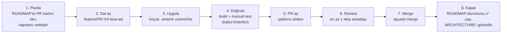
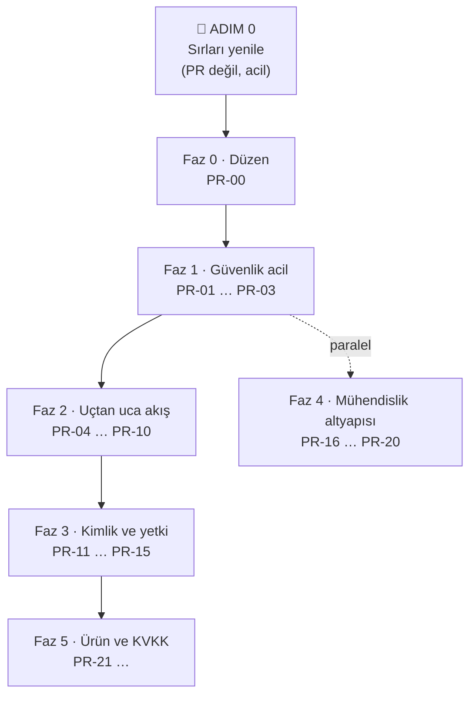

# ParroTalk — PR Yol Haritası

> Bu dosya [ARCHITECTURE.md](ARCHITECTURE.md)'deki bulguların **önceliklendirilmiş iş planıdır**.
> Her satır bir PR'dır. PR açıldığında/merge edildiğinde **Durum** sütununu aynı PR içinde güncelleyin.
>
> **Repo kısaltmaları:** `BE` = [BackendApi](https://github.com/bitirmesel/BackendApi) · `UN` = [GraduationProject](https://github.com/bitirmesel/GraduationProject) (Unity) · `FL` = Flutter terapist paneli
>
> **Durum:** ⬜ başlamadı · 🟨 PR açık · ✅ merge edildi · ⏸️ beklemede

---

## 1. Nasıl çalışacağız?

### 1.1 Bir PR'ın yaşam döngüsü

Her adımda ne yaptığımızı açıkça yazarız: PR açıklamasında **Ne / Neden / Nasıl test edildi / Riskler** bölümleri zorunludur (bkz. `.github/pull_request_template.md`).

### 1.2 Kurallar

| Kural | Açıklama |
|---|---|
| **`main`'e doğrudan push yok** | `main` = Render'a otomatik deploy edilen kod. Her değişiklik PR ile girer. GitHub'da branch protection açılması önerilir (bkz. PR-00). |
| **Dal adı** | `feature/PR-04-telaffuz-dto`, `fix/PR-09-kart-url` — ROADMAP'teki ID ile başlar. |
| **PR başlığı** | `[PR-04] Unity: telaffuz yanıtını PronunciationResultDto ile oku` |
| **Küçük PR** | Bir PR tek bir amaca hizmet eder; ~400 satırı geçiyorsa bölünür. Unity sahne (`.unity`) değişikliği olan PR'lar başka sahne PR'ı ile paralel açılmaz. |
| **Geriye uyumluluk** | BE merge'ü anında canlıya çıkar. BE PR'ı, **kullanımdaki Unity sürümünü kırmamalı**. Kırıcı değişiklik gerekiyorsa önce yeni yol/alan eklenir, istemciler geçer, eski yol sonra kaldırılır. |
| **Çok repolu iş** | Her repo kendi PR'ını alır; açıklamalarda birbirine link verilir. Merge sırası kartta yazılıdır (genelde **BE önce**). |
| **Merge yöntemi** | Squash merge — `main` geçmişinde her PR tek commit olur. |
| **Tanım: Bitti** | Kabul kriterleri sağlandı + review onayı + ROADMAP/ARCHITECTURE güncellendi + (BE ise) canlıda Swagger'dan doğrulandı. |
| **Manuel adımlar** | 🔑 işaretli adımları (panel ayarları, şifre yenileme) yalnızca hesap sahibi yapar; PR açıklamasında "merge öncesi/sonrası yapılacaklar" olarak yazılır. |

### 1.3 Roller

- **Uygulayıcı** (Claude veya bir ekip üyesi): dalı açar, kodu yazar, kendi doğrulamasını yapar, PR'ı açar.
- **Reviewer** (en az bir ekip üyesi): kodu okur, kabul kriterlerini dener, onaylar.
- **Merge eden:** review onayından sonra PR sahibi veya reviewer. Claude merge etmez; yalnızca açıkça istenirse.

---

## 2. Genel Bakış

Faz 2, tez demosunda "çocuk oynar → terapist görür" akışını çalışır hale getirdiği için **en yüksek ürün değerine** sahiptir; ama Faz 1 bitmeden başlanmaz çünkü repolar herkese açık ve sırlar şu an ifşa durumda.

| ID | Faz | Repo | Başlık | Öncelik | Bağımlılık | Durum |
|---|---|---|---|---|---|---|
| ADIM 0 | 0 | 🔑 | Sızan sırları yenile (rotate) | **P0** | — | ⬜ |
| PR-00 | 0 | UN+BE | Mimari doküman, yol haritası, PR şablonu | P0 | — | 🟨 |
| PR-01 | 1 | BE | Sırları koddan çıkar, ortam değişkenlerine taşı | **P0** | ADIM 0 | ⬜ |
| PR-02 | 1 | BE | Kişisel veri sızıntısını durdur (DTO, hata detayı, Swagger) | **P0** | — | ⬜ |
| PR-03 | 1 | BE | Yerel geliştirme veritabanı (docker-compose + seed) | P0 | PR-01 | ⬜ |
| PR-04 | 2 | UN | Telaffuz yanıtını `PronunciationResultDto` ile oku | **P1** | — | ⬜ |
| PR-05 | 2 | BE | Oturum başlatmada AssetSet'i otomatik çöz + `assetSetId` dön | P1 | — | ⬜ |
| PR-06 | 2 | UN | Oyun oturumunu kaydet (start / complete + görev) | **P1** | PR-04, PR-05 | ⬜ |
| PR-07 | 2 | BE | `GET /api/assets/sets` (tip + zorluk ile asset seti) | P1 | — | ⬜ |
| PR-08 | 2 | UN | LevelMap'i gerçek veriye bağla, mock'u kaldır, harf ID'lerini lookup'tan al | P1 | PR-07 | ⬜ |
| PR-09 | 2 | UN | Hece oyununu bağla (`GameLoader`, `check-syllable`, tek başlatıcı) | P1 | PR-04, PR-08 | ⬜ |
| PR-10 | 2 | UN | Küçük düzeltmeler: bildirim sayısı, kart URL'i, AudioManager | P1 | — | ⬜ |
| PR-11 | 3 | BE | Şifre hash'leme (şeffaf geçiş ile) | P1 | PR-02 | ⬜ |
| PR-12 | 3 | BE | Oyuncu için JWT + rol claim'leri | P1 | PR-11 | ⬜ |
| PR-13 | 3 | UN | Token'ı sakla ve her istekte gönder | P1 | PR-12 | ⬜ |
| PR-14 | 3 | FL | Token'ı her istekte gönder | P1 | PR-12 | ⬜ |
| PR-15 | 3 | BE | Endpoint'leri yetkilendir + sahiplik kontrolü | P1 | PR-13, PR-14 | ⬜ |
| PR-16 | 4 | BE | Test projesi + `PronunciationScoringService` birim testleri | P2 | — | ⬜ |
| PR-17 | 4 | BE | GitHub Actions: build + test | P2 | PR-16 | ⬜ |
| PR-18 | 4 | BE | `ILogger`, global hata yakalama, UTC tutarlılığı | P2 | PR-02 | ⬜ |
| PR-19 | 4 | BE | Ölü kod temizliği (mock, FluentMeService, Dapper, `Dtos.cs`) | P2 | PR-07 | ⬜ |
| PR-20 | 4 | UN | Ölü kod temizliği, tek API ayar dosyası, `async void` güvenliği | P2 | PR-09 | ⬜ |
| PR-21 | 5 | BE | Ses kaydı saklama politikası + veli onayı alanları | P1 | PR-15 | ⬜ |
| PR-22 | 5 | UN | Davet kodu ile terapiste bağlanma ekranı | P2 | PR-13 | ⬜ |
| PR-23+ | 5 | UN+BE | Yeni oyunlar (Kelime S2/S3, Cümle S1-S3) — her oyun ayrı PR | P2 | PR-09 | ⬜ |

---

## 3. Faz 0 — Düzen ve acil müdahale

### ADIM 0 · 🔑 Sızan sırları yenile (PR değil)

> **Neden PR'dan önce?** Repolar **public**. Git geçmişindeki şifreler kod silinse de okunabilir. Tek etkili çözüm şifreleri geçersiz kılmaktır.

Hesap sahibinin yapacakları:

1. **Render → PostgreSQL:** veritabanı kullanıcısının şifresini yenile (veya yeni kullanıcı oluştur), yeni connection string'i not al.
2. **Render → Web Service → Environment:** `ConnectionStrings__Pg` = yeni connection string. Kaydet → servis yeniden başlar, uygulama yeni şifreyle çalışmaya devam eder (kod env'i `appsettings.json`'dan önce okur).
3. **thefluent.me:** hesap şifresini değiştir, API anahtarını yenile.
4. **JWT:** en az 32 karakterlik rastgele bir anahtar üret, Render'a `Jwt__Key` olarak ekle. (Mevcut terapist oturumları bir kez düşer; tekrar giriş yeterli.)
5. Cloudinary ve OpenAI anahtarları koda hiç girmediği için yenileme zorunlu değil.

✔️ **Bitti sayılır:** Eski DB şifresiyle bağlantı reddediliyor, canlı uygulama çalışıyor.

> FluentMe yeni bilgileri PR-01 merge edilene kadar koda yazılmaz; PR-01 env'den okumayı ekleyene dek kelime telaffuz hattı geçici olarak çalışmayabilir. Bu kabul edilebilir bir kısa kesinti — ya da PR-01 önce hazırlanıp ADIM 0 ile aynı gün merge edilir.

### PR-00 · UN+BE · Dokümantasyon ve PR düzeni

- **Ne:** `ARCHITECTURE.md`, `ROADMAP.md` (UN), her iki repoya `.github/pull_request_template.md`.
- **Neden:** Ortak referans ve her PR'da adımların yazılı olması.
- **Merge sonrası 🔑:** GitHub → Settings → Branches → `main` için *Require a pull request before merging* + *Require approvals: 1*.
- ✔️ Yeni PR açıldığında şablon otomatik geliyor; `main`'e doğrudan push reddediliyor.

---

## 4. Faz 1 — Güvenlik (acil)

### PR-01 · BE · Sırları koddan çıkar

**Adımlar**
1. `appsettings.json` ve `appsettings.Development.json`'dan connection string'i sil; JWT `Key` değerini boşalt.
2. `PronunciationController`'daki sabit FluentMe bilgilerini `FluentMe:User`, `FluentMe:Password`, `FluentMe:ApiKey` yapılandırmasına taşı (Render'da `FluentMe__User` vb.). Basit bir `FluentMeOptions` sınıfıyla bağla.
3. `Program.cs`: JWT anahtarı yoksa veya 32 karakterden kısaysa **açılışta hata ver** (sessiz varsayılan yok). Artık işe yaramayan `FLUENT_USER` log bloğunu kaldır.
4. README'ye yerel kurulum: `dotnet user-secrets set ...` komutları.

**Kabul kriterleri:** `git grep` ile repoda şifre/anahtar bulunmuyor · uygulama env değişkenleriyle ayağa kalkıyor · `/api/pronunciation/check` canlıda çalışıyor.
**🔑 Merge öncesi:** Render'a `FluentMe__User`, `FluentMe__Password`, `FluentMe__ApiKey` ekle.
**Risk:** Env eksikse servis açılmaz → Render loglarından hemen görülür.

### PR-02 · BE · Kişisel veri sızıntısını durdur

**Adımlar**
1. `GET /api/students/{id}`, `GET/PUT /api/therapists/{id}`: entity yerine DTO dön (şifre alanı yok).
2. `GET /api/students` içindeki stack trace döndüren geçici `catch`'i kaldır.
3. Asset endpoint'lerindeki `ex.Message` / inner exception dönüşlerini genel mesajla değiştir (detay loglansın).
4. Swagger'ı yalnızca `Development`'ta veya `ENABLE_SWAGGER=true` ise aç (Flutter ekibi canlıda kullanıyorsa env ile açık tutulabilir).

**Kabul kriterleri:** Hiçbir yanıtta `password` alanı yok · 500 hatalarında stack trace yok · alan adları değişmediği için Flutter/Unity etkilenmiyor.

### PR-03 · BE · Yerel geliştirme veritabanı

**Adımlar**
1. `docker-compose.yml`: PostgreSQL 16.
2. `appsettings.Development.json` → `localhost` bağlantısı.
3. Seed: `letters`, `game_types`, `difficulty_levels`, `games` (ID 1-10) ve örnek bir `asset_set` (SQL script veya `--seed` komutu).
4. README: "5 dakikada yerel kurulum".

**Kabul kriterleri:** `docker compose up -d` + `dotnet run` ile prod'a dokunmadan Swagger çalışıyor · migration'lar temiz DB'de baştan sona uygulanıyor.
**Not:** Baseline migration boş olduğu için temiz DB'de tablolar oluşmayabilir → bu PR'da baseline şemanın SQL'i (prod'dan `pg_dump --schema-only`) eklenir.

---

## 5. Faz 2 — Uçtan uca akış (tez demosu için kritik)

### PR-04 · UN · Telaffuz yanıtını doğru oku

**Adımlar**
1. `Models/PronunciationResultDto.cs` ekle (`score`, `passed`, `transcript`, `feedback_key`, …).
2. `PronunciationManager` ve `SyllableExerciseManager`: önce yeni DTO'yu dene; olmazsa eski FluentMe dizi formatına düş (backend'in parse-hata fallback'i hâlâ ham dizi dönebiliyor).
3. Geçme kararı için backend'in `passed` alanını kullan (eşik tek yerde: backend).
4. `feedback_key` → çocuğa uygun Türkçe mesaj eşlemesi (`no_audio` → "Sesini duyamadım, tekrar dener misin?").

**Kabul kriterleri:** Doğru söylenen kelime ilk denemede geçiyor · ses yoksa anlamlı mesaj çıkıyor · Editor'da ve Android'de denendi.

### PR-05 · BE · Oturum başlatmayı kolaylaştır

**Adımlar**
1. `POST /api/gamesessions/start`: `AssetSetId` yoksa `(GameId, LetterId)` ile `asset_sets`'ten bul.
2. `GET /api/gameconfig/{g}/{l}` yanıtı ham JSON olduğu için değiştirilmez; bunun yerine `start` yanıtına `assetSetId` eklenir.

**Kabul kriterleri:** Yalnızca `{playerId, gameId, letterId, taskId?}` ile oturum açılıyor · eski istek biçimi de çalışıyor (geriye uyumlu).

### PR-06 · UN · Oyun oturumunu kaydet

**Adımlar**
1. `APIManager`: `StartSessionAsync`, `SaveProgressAsync`, `CompleteSessionAsync`; kullanılmayan `SavePronunciationScoreAsync` (`/finish`) silinir.
2. `BaseGameManager`'a ortak akış: oyun başında start, her kelime/hece sonucunda item biriktir, bitişte complete.
3. `GameContext.CurrentTaskId` varsa oturuma bağla → görev `COMPLETED` olur.
4. Oyun yarıda bırakılırsa (`OnDestroy` / geri tuşu) `progress` gönder.

**Kabul kriterleri:** Oyun bitince Flutter panelinde oturum + kelime bazlı skorlar görünüyor · görevden girilen oyun bitince görev tamamlandı görünüyor.
**Merge sırası:** PR-05 (BE) → PR-06 (UN).

### PR-07 · BE · `GET /api/assets/sets`

**Adımlar**
1. Sorgu: `letterId`, `gameType` (`SYLLABLE|WORD|SENTENCE`), `difficulty` (1-3) → `games` tablosundan `game_type.code` + `difficulty_level.level` ile oyunu bul → `asset_sets` kaydını getir.
2. `asset_json`'u Unity'nin beklediği normalize biçime çevir: `{ assetSetId, gameId, letterId, letterCode, gameType, difficulty, cardBackUrl, items:[{imageUrl, audioUrl, syllableText}] }` (`base_url + file` birleştirmesi backend'de yapılır).
3. Kayıt yoksa `404` + açıklayıcı mesaj.

**Kabul kriterleri:** Swagger'da üç tip × üç zorluk için doğru set dönüyor · eksik olan için 404.
**Açık soru:** DB'deki gerçek `asset_json` biçimi (bkz. ARCHITECTURE §11-2) bu PR'ın ilk adımında kontrol edilir.

### PR-08 · UN · LevelMap'i gerçek veriye bağla

**Adımlar**
1. `GetAssetSetAsync`'teki mock fallback'i kaldır; hata durumunda kullanıcıya "İçerik henüz hazır değil" göster.
2. Harf ID'lerini sabit diziden değil `GET /api/lookup/letters` yanıtından eşle (`letterCode → id`).
3. `GameContext.SelectedGameId`'yi yanıttaki `gameId` ile doldur; `GameLoader` metin yerine ID ile modül seçsin.

**Kabul kriterleri:** Her harf butonu DB'deki doğru `letterId` ile istek atıyor · içerik olmayan kombinasyonda çökme/sessiz mock yok.

### PR-09 · UN · Hece oyununu bağla

**Adımlar**
1. `SyllableExerciseManager` için prefab oluştur; `GameLoader.GameModules`'e ID 1, 2, 3 olarak ekle.
2. Hece değerlendirmesini `/api/pronunciation/check-syllable`'a yönlendir.
3. GameScene'de tek başlatıcı: `GameSceneController`'daki `InitializeGame` çağrısını kaldır, yalnızca `GameLoader` kalsın.
4. PR-06'daki oturum kaydını hece oyununa da uygula (`item_type = SYLLABLE`).

**Kabul kriterleri:** LevelMap → Hece sekmesi → zorluk seçimi hece oyununu açıyor · her hece Whisper ile değerlendiriliyor · oyun bir kez başlatılıyor.

### PR-10 · UN · Küçük düzeltmeler

1. Okunmamış sayısı → `GET /api/players/{id}/inbox/unread-count`; "test için 1'e zorla" kodu silinir.
2. `PronunciationManager.CreatePronunciationCard`: görsel URL'i `config.BaseUrl + file` olsun (backend adresi değil).
3. `AudioManager`'ı LoginScene'e ekle (`DontDestroyOnLoad`), `PlayEffect`'i uygula.
4. Kelime düzeltme `if`'leri (`kopek→köpek`): asset JSON'a `text` alanı eklenene dek tek bir sözlüğe taşınır.

---

## 6. Faz 3 — Kimlik ve yetki

> **Strateji:** Kırıcı değişikliği üç adımda yayıyoruz → (1) backend token üretir, (2) istemciler token gönderir, (3) backend zorunlu kılar. Böylece hiçbir anda canlı uygulama kırılmaz.

### PR-11 · BE · Şifre hash'leme
- ASP.NET `PasswordHasher<T>` kullanılır. **Şeffaf geçiş:** girişte kayıtlı şifre hash değilse düz metinle karşılaştır, başarılıysa hash'leyip kaydet. Kayıt, şifre değiştirme ve PATCH yolları hash yazar.
- ✔️ Mevcut kullanıcılar şifrelerini değiştirmeden girebiliyor; DB'de yeni/girmiş kullanıcıların şifresi hash.

### PR-12 · BE · Oyuncu JWT'si
- `/api/player/auth/login` yanıtına `token` eklenir (`role=player`, `playerId` claim). Terapist token'ına da `role=therapist` zaten var. Yanıtın mevcut alanları korunur.

### PR-13 · UN / PR-14 · FL · Token gönderimi
- UN: token `PlayerPrefs`'te saklanır, `APIManager` tüm isteklere `Authorization: Bearer` ekler, `401`'de login'e döner.
- FL: aynı davranış (Flutter reposunda).

### PR-15 · BE · Yetkilendirme
- Endpoint grupları `MapGroup` ile toplanır, `.RequireAuthorization("therapist" | "player")`.
- **Sahiplik:** terapist yalnızca `therapist_clients`'taki çocukları; oyuncu yalnızca kendi `playerId`'sini görür. `therapistId`/`playerId` sorgu parametresi yerine token'dan okunur.
- Açık kalanlar: login/register, lookup, `invitations/redeem` (oyuncu token'ı ile).
- Debug endpoint'leri (`/api/players`, `/api/tasks`, `/api/gamesessions/all`, `/api/admin/*`) `admin` rolüne veya yalnızca Development'a alınır.
- ✔️ Token'sız istek `401`, başkasının verisi `403`.

---

## 7. Faz 4 — Mühendislik altyapısı (Faz 1'den sonra paralel yürüyebilir)

| PR | İçerik | Kabul |
|---|---|---|
| **PR-16** BE | `DktApi.Tests` (xUnit). `PronunciationScoringService` tablo testleri (`exact_match`, `length_variant`, Türkçe karakterler…). | `dotnet test` yeşil |
| **PR-17** BE | `.github/workflows/backend.yml`: restore → build → test her PR'da. | PR'larda yeşil tik |
| **PR-18** BE | `Console.WriteLine` → `ILogger`; `UseExceptionHandler` + ProblemDetails; `DateTime.Now` → `UtcNow`. | Loglar Render'da seviyeli; 500'ler tek biçimde |
| **PR-19** BE | `GameConfigController` mock'u, `FluentMeService`, Dapper paketi, csproj'daki yorum bloğu, `Dtos.cs`, `Models/FluentMe` kullanılmayanlar. | Build temiz, davranış aynı |
| **PR-20** UN | Kullanılmayan script/sahneleri sil (`LoginManager`, `Login_Scene`, `PronunciationDemo/Api`, `TestGame`, `WavUtility`, fazladan drag script'leri); base URL'leri tek `ApiConfig` ScriptableObject'e topla; `async void` handler'ları try/catch ile sar. | Uygulama aynı çalışıyor, uyarı sayısı düştü |

---

## 8. Faz 5 — Ürün ve KVKK

| PR | İçerik |
|---|---|
| **PR-21** BE | Değerlendirme sonrası Cloudinary'deki kaydı sil (veya private/authenticated teslimata geç); `players`'a `guardian_consent_at` alanı; KVKK aydınlatma metni için endpoint. |
| **PR-22** UN | Ayarlar → "Terapistime bağlan" ekranı: davet kodu gir → `/api/invitations/redeem`. |
| **PR-23+** | Her yeni oyun için ayrı PR: içerik (asset JSON) + Unity modülü + oturum kaydı. Sıra önerisi: Kelime S2 (Üçlü Eşleştir) → Cümle S1. |
| **Karar** | `ş/s`, `ç/c`, `ı/i` ayrımı puanlamada korunacak mı? (ARCHITECTURE §11-6) — karar sonrası PR-16 testleriyle birlikte uygulanır. |

---

## 9. Değişiklik günlüğü

| Tarih | Değişiklik |
|---|---|
| 2026-10-16 | İlk sürüm (PR-00). |
